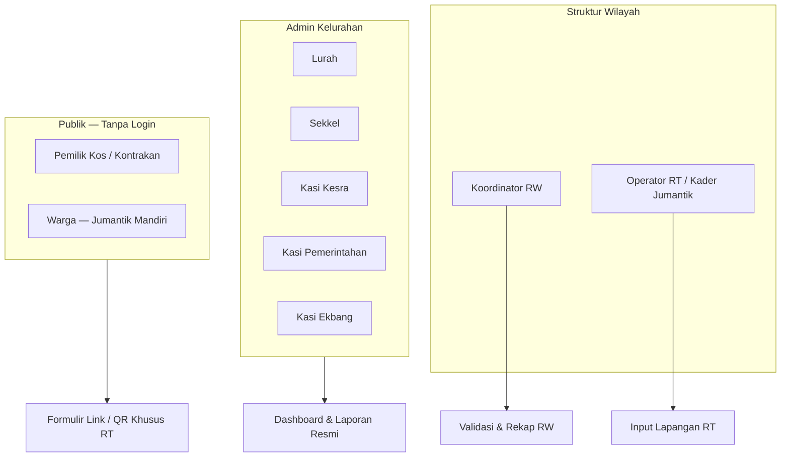
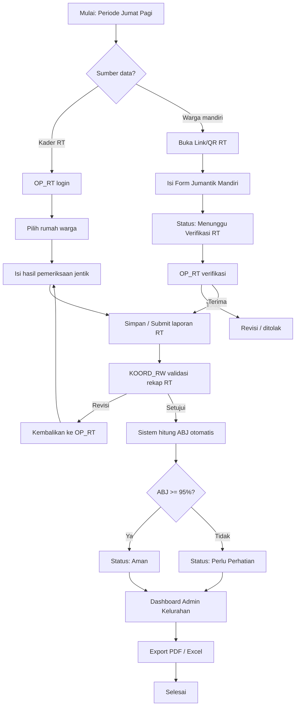
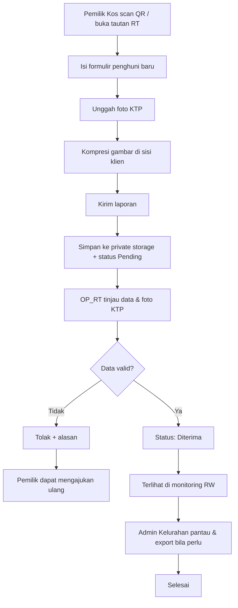
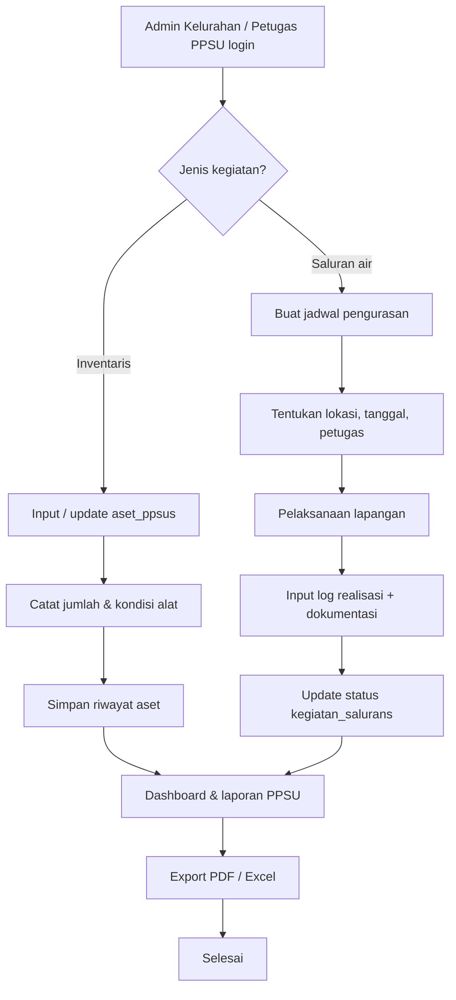
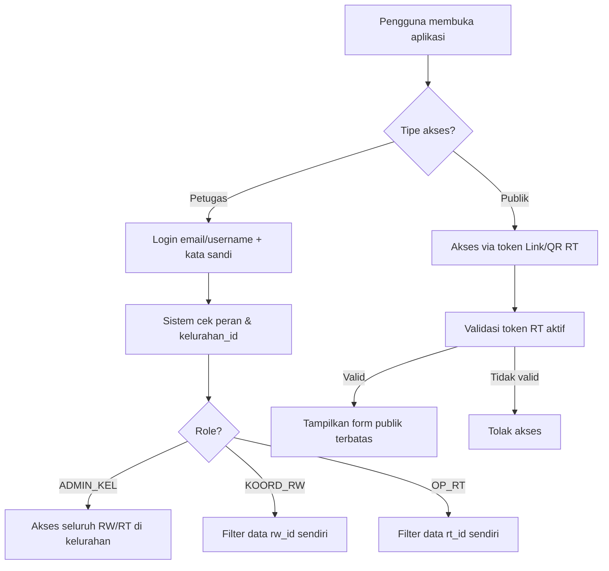
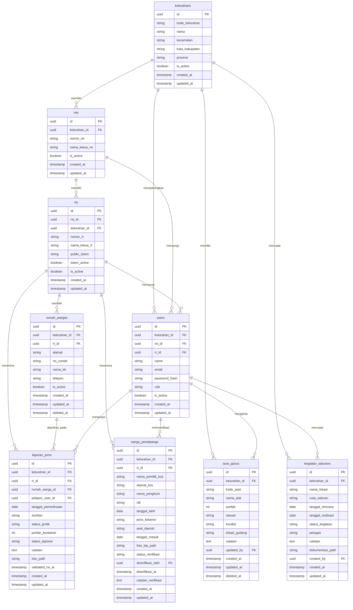
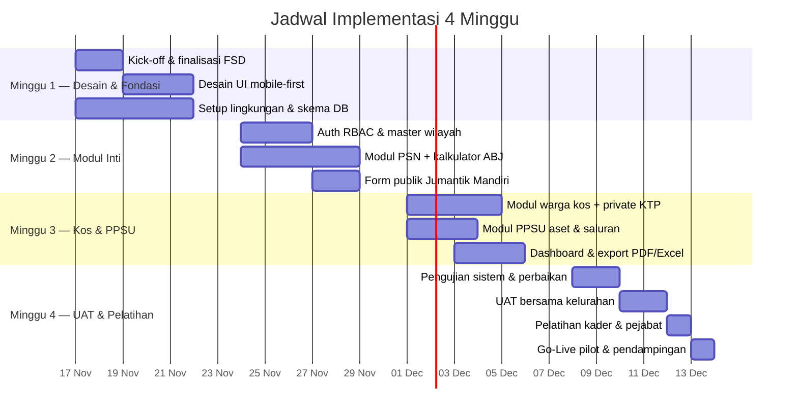

# FUNCTIONAL SPECIFICATION DOCUMENT (FSD)

## Sistem Informasi Monitoring PSN Jumantik, Pendataan Warga Non-Permanen (Kos/Kontrakan), dan Log Operasional PPSU Tingkat Kelurahan

| | |
|:---|:---|
| **Kode Dokumen** | FSD-KEL-PSN-PPSU-001 |
| **Versi** | 1.0 |
| **Tanggal** | 14 November 2026 |
| **Status** | Final — Siap Presentasi |
| **Klasifikasi** | Internal Kelurahan |
| **Disiapkan untuk** | Pimpinan Kelurahan (Lurah) dan jajaran struktural |
| **Wilayah penerapan** | Tingkat Kelurahan — Provinsi DKI Jakarta |

---

### Lembar Pengesahan

| Peran | Nama / Jabatan | Tanda Tangan | Tanggal |
|:---|:---|:---|:---|
| Disusun oleh | Tim Pengembang Sistem | | |
| Dikaji oleh | Sekretaris Kelurahan | | |
| Disetujui oleh | Lurah | | |

---

### Daftar Isi

1. [BAB 1 — PENDAHULUAN](#bab-1-pendahuluan)
2. [BAB 2 — ARSITEKTUR PENGGUNA & MATRIKS HAK AKSES](#bab-2-arsitektur-pengguna--matriks-hak-akses)
3. [BAB 3 — SPESIFIKASI FUNGSIONAL & USER FLOW](#bab-3-spesifikasi-fungsional--user-flow)
4. [BAB 4 — RANCANGAN STRUKTUR DATABASE MULTI-TENANT](#bab-4-rancangan-struktur-database-multi-tenant)
5. [BAB 5 — SPESIFIKASI ANTARMUKA (UI/UX) & KEBUTUHAN NON-FUNGSIONAL](#bab-5-spesifikasi-antarmuka-uiux--kebutuhan-non-fungsional)
6. [BAB 6 — RENCANA PENGUJIAN (UAT) & TIMELINE IMPLEMENTASI](#bab-6-rencana-pengujian-uat--timeline-implementasi)
7. [Lampiran](#lampiran)

---

# BAB 1: PENDAHULUAN

## 1.1 Latar Belakang

Kantor Kelurahan di wilayah Provinsi DKI Jakarta menjalankan sejumlah tugas operasional rutin yang bersifat lintas sektor, antara lain:

1. **Pemberantasan Sarang Nyamuk (PSN) Jumantik** — kader Jumantik di tingkat RT melakukan pemeriksaan jentik rumah tangga setiap Jumat pagi, kemudian melaporkan hasilnya kepada koordinator RW dan jajaran kelurahan.
2. **Pendataan warga non-permanen (kos/kontrakan)** — pemilik kos atau kontrakan diwajibkan melaporkan penghuni baru kepada RT/RW sebagai bagian dari ketertiban wilayah dan keamanan sosial.
3. **Log operasional PPSU** — Petugas Penanganan Prasarana dan Sarana Umum mencatat inventaris gudang alat serta jadwal pengurasan saluran air di wilayah kelurahan.

Saat ini, ketiga proses tersebut masih banyak bergantung pada **pekerjaan manual**: rekap laporan kader Jumantik dari pesan WhatsApp ke berkas Excel, pendataan warga kos per RT/RW yang tersebar di catatan kertas atau spreadsheet terpisah, serta pencatatan gudang alat dan jadwal saluran PPSU yang belum terintegrasi. Kondisi ini menimbulkan risiko:

- keterlambatan rekap dan inkonsistensi data antar-RT/RW;
- kesulitan menghitung **Angka Bebas Jentik (ABJ)** secara cepat dan akurat;
- celah pelaporan warga kos baru yang tidak terdokumentasi dengan baik;
- lemahnya jejak audit (audit trail) untuk keperluan laporan resmi ke kecamatan/kota.

Sistem yang diusulkan merupakan **sistem pendukung internal tingkat kelurahan**. Sistem ini **bukan pengganti** aplikasi resmi Pemerintah Provinsi DKI Jakarta (seperti JAKI atau sistem pusat lainnya), melainkan pelengkap operasional harian agar data lapangan lebih tertib, terstruktur, dan siap diekspor menjadi laporan resmi.

## 1.2 Tujuan

### 1.2.1 Tujuan Umum

Membangun sistem informasi internal kelurahan yang mengintegrasikan monitoring PSN Jumantik, pendataan warga kos/kontrakan, dan log operasional PPSU dalam satu platform multi-peran (multi-role) yang aman, mudah digunakan, dan dapat direplikasi ke kelurahan lain.

### 1.2.2 Tujuan Khusus

| No | Tujuan Khusus | Indikator Keberhasilan |
|:---:|:---|:---|
| 1 | Menghilangkan rekap manual WhatsApp → Excel untuk laporan Jumat pagi Jumantik | Laporan RT masuk sistem ≤ hari yang sama; ABJ terhitung otomatis |
| 2 | Menyediakan saluran pelaporan mandiri pemilik kos via tautan/QR khusus RT | ≥ 80% laporan kos baru masuk melalui formulir digital pada uji coba |
| 3 | Mencatat aset gudang dan jadwal pengurasan saluran PPSU secara digital | Inventaris dan jadwal tersimpan, dapat ditelusuri per periode |
| 4 | Menyediakan dashboard monitoring bagi pejabat kelurahan | Dashboard ABJ, status RT/RW, dan ringkasan warga pendatang tersedia real-time |
| 5 | Menghasilkan ekspor laporan resmi PDF/Excel | Format laporan sesuai kebutuhan internal kelurahan |

## 1.3 Ruang Lingkup Sistem

Sistem mencakup tiga modul utama berikut.

| Modul | Cakupan Fungsional |
|:---|:---|
| **Modul PSN Jumantik** | Input pemeriksaan jentik rumah tangga, validasi berjenjang RT → RW → Kelurahan, kalkulator ABJ otomatis (standar aman ≥ 95%), dashboard grafik, dan ekspor laporan |
| **Modul Warga Kos/Kontrakan** | Formulir publik (tanpa login) via tautan/QR RT, unggah foto KTP, verifikasi oleh Operator RT, monitoring oleh Koordinator RW dan Admin Kelurahan |
| **Modul PPSU** | Master aset gudang alat, pencatatan kondisi/stok, penjadwalan dan log kegiatan pengurasan saluran air, laporan operasional |

**Termasuk dalam ruang lingkup:**

- Autentikasi dan otorisasi berbasis peran (RBAC);
- Master data wilayah (Kelurahan → RW → RT) bersifat multi-tenant agar mudah digandakan ke kelurahan lain;
- Dashboard monitoring dan ekspor PDF/Excel;
- Formulir publik Jumantik Mandiri dan pelaporan penghuni kos;
- Penyimpanan privat untuk foto KTP;
- Antarmuka mobile-first untuk kader lapangan.

**Tidak termasuk dalam ruang lingkup (lihat Batasan):**

- Integrasi API resmi ke JAKI atau sistem Pemprov DKI lainnya (kecuali disepakati pada fase terpisah);
- Penggantian sistem kependudukan resmi (Dukcapil / SIAK);
- Modul keuangan, penggajian, atau layanan administrasi surat yang sudah ada di aplikasi lain.

## 1.4 Batasan Masalah

1. Sistem bersifat **pendukung operasional internal kelurahan**, bukan sistem resmi Pemprov DKI dan tidak menggantikan JAKI.
2. Data kependudukan warga permanen **tidak** disinkronkan otomatis dengan Dukcapil; data rumah warga diinput/ dikelola oleh petugas RT/kelurahan sesuai kebutuhan operasional.
3. Formulir publik hanya dapat diakses melalui **tautan atau QR Code khusus per RT** (bukan direktori terbuka ke seluruh kota).
4. Foto KTP disimpan pada **penyimpanan privat** dengan kontrol akses; sistem tidak mempublikasikan foto KTP ke halaman terbuka.
5. Perhitungan ABJ mengikuti rumus operasional yang disepakati kelurahan:  
   **ABJ (%) = (Jumlah rumah bebas jentik / Jumlah rumah diperiksa) × 100**, dengan **ambang aman ≥ 95%**.
6. Penerapan awal ditujukan pada **satu kelurahan pilot**; arsitektur multi-tenant disiapkan untuk replikasi, namun onboarding kelurahan lain merupakan kegiatan pasca-pilot.
7. Jadwal implementasi yang diacu dalam dokumen ini adalah **4 (empat) minggu** dari fase desain hingga pelatihan kader.

## 1.5 Definisi Istilah

| Istilah | Pengertian |
|:---|:---|
| **PSN** | Pemberantasan Sarang Nyamuk |
| **Jumantik** | Juru Pemantau Jentik |
| **ABJ** | Angka Bebas Jentik |
| **PPSU** | Penanganan Prasarana dan Sarana Umum |
| **RBAC** | Role-Based Access Control (kendali akses berbasis peran) |
| **Multi-tenant** | Arsitektur data yang memisahkan data per kelurahan (tenant) agar dapat digandakan |
| **UAT** | User Acceptance Testing (pengujian penerimaan pengguna) |
| **Warga non-permanen** | Penghuni kos/kontrakan yang tinggal sementara di wilayah RT |

---

# BAB 2: ARSITEKTUR PENGGUNA & MATRIKS HAK AKSES

## 2.1 Aktor Sistem

Sistem menerapkan model **RBAC (Role-Based Access Control)** dengan empat kelompok aktor utama.

### 2.1.1 Deskripsi Peran

| Kode Peran | Nama Peran | Deskripsi Tanggung Jawab |
|:---|:---|:---|
| `ADMIN_KEL` | Admin Kelurahan (Lurah, Sekkel, Kasi Kesra, Kasi Pemerintahan, Kasi Ekbang) | Monitoring seluruh RW/RT, grafik ABJ, manajemen master wilayah, ekspor laporan resmi PDF/Excel, pengawasan warga pendatang dan operasional PPSU |
| `KOORD_RW` | Koordinator RW | Validasi dan rekap data RT di bawah naungan RW-nya; monitoring ABJ tingkat RW |
| `OP_RT` | Operator RT / Kader Jumantik | Input pemeriksaan jentik rumah tangga (Jumat pagi), verifikasi laporan penghuni kos baru di RT-nya, pengelolaan tautan/QR publik RT |
| `PUBLIK` | Publik / Pemilik Kos (tanpa login) | Mengisi formulir pelaporan mandiri penghuni kos/kontrakan baru (termasuk unggah foto KTP) dan formulir Jumantik Mandiri melalui tautan/QR khusus RT |

## 2.2 Matriks Hak Akses (CRUD + Export)

Keterangan simbol: **C** = Create, **R** = Read, **U** = Update, **D** = Delete, **E** = Export.  
Tanda **✓** = diizinkan; **—** = tidak diizinkan; **S** = terbatas pada wilayah sendiri (scope RT/RW).

### 2.2.1 Master Data & Akun

| Objek / Fitur | ADMIN_KEL | KOORD_RW | OP_RT | PUBLIK |
|:---|:---:|:---:|:---:|:---:|
| Master Kelurahan | CRUD | R (S) | R (S) | — |
| Master RW | CRUD | R (S) | R (S) | — |
| Master RT | CRUD | R (S) | R (S) | — |
| Manajemen Pengguna (akun petugas) | CRUD | R (S) | R (profil sendiri) | — |
| Tautan / QR Form Publik per RT | CRUD | R (S) | CRU (S) | — (hanya akses form) |

### 2.2.2 Modul PSN Jumantik

| Objek / Fitur | ADMIN_KEL | KOORD_RW | OP_RT | PUBLIK |
|:---|:---:|:---:|:---:|:---:|
| Data rumah warga (master rumah) | CRUD | RU (S) | CRU (S) | — |
| Laporan PSN / pemeriksaan jentik | CRUD / E | RU (S) / E (S) | CRU (S) | C (Jumantik Mandiri) |
| Validasi laporan RT | R / U (override) | U (validasi RW) | U (submit RT) | — |
| Dashboard & grafik ABJ | R / E (semua RW) | R / E (RW sendiri) | R (RT sendiri) | — |
| Ambang ABJ & parameter | RU | R | R | — |

### 2.2.3 Modul Warga Kos/Kontrakan

| Objek / Fitur | ADMIN_KEL | KOORD_RW | OP_RT | PUBLIK |
|:---|:---:|:---:|:---:|:---:|
| Laporan warga pendatang | CRUD / E | RU (S) / E (S) | RU (S) verifikasi | C (+ unggah KTP) |
| Lihat foto KTP (private) | R | R (S) | R (S) | — (hanya unggah) |
| Status verifikasi (Pending / Diterima / Ditolak) | RU | RU (S) | RU (S) | R (status ringkas via token, opsional) |

### 2.2.4 Modul PPSU

| Objek / Fitur | ADMIN_KEL | KOORD_RW | OP_RT | PUBLIK |
|:---|:---:|:---:|:---:|:---:|
| Aset gudang PPSU | CRUD / E | R (jika diizinkan kelurahan) | — | — |
| Kegiatan / jadwal pengurasan saluran | CRUD / E | R (S, opsional) | — | — |
| Log operasional PPSU | CRUD / E | R | — | — |

### 2.2.5 Ringkasan Hak Export

| Jenis Ekspor | ADMIN_KEL | KOORD_RW | OP_RT | PUBLIK |
|:---|:---:|:---:|:---:|:---:|
| Laporan ABJ PDF/Excel | ✓ (seluruh wilayah) | ✓ (RW sendiri) | — | — |
| Rekap warga pendatang PDF/Excel | ✓ | ✓ (RW sendiri) | — | — |
| Laporan operasional PPSU PDF/Excel | ✓ | — | — | — |

## 2.3 Prinsip Keamanan Akses

1. Setiap akun petugas terikat pada **satu `kelurahan_id`** (tenant) dan, bila relevan, pada `rw_id` / `rt_id`.
2. Pengguna **tidak dapat** membaca atau mengubah data di luar cakupan wilayahnya (row-level security / scope filter).
3. Peran Publik **tidak memiliki akun login**; akses hanya melalui token tautan/QR yang diterbitkan per RT.
4. Semua aksi ubah data penting dicatat dalam **audit log** (siapa, kapan, apa yang berubah).

---

# BAB 3: SPESIFIKASI FUNGSIONAL & USER FLOW

## 3.1 Ringkasan Kebutuhan Fungsional

| Kode | Modul | Judul Kebutuhan |
|:---|:---|:---|
| FR-01 | PSN Jumantik | Manajemen master rumah warga per RT |
| FR-02 | PSN Jumantik | Input pemeriksaan jentik (Jumat pagi) oleh Operator RT |
| FR-03 | PSN Jumantik | Formulir Jumantik Mandiri (publik via link/QR) |
| FR-04 | PSN Jumantik | Validasi berjenjang RT → RW → Kelurahan |
| FR-05 | PSN Jumantik | Kalkulator ABJ otomatis & indikator ambang aman ≥ 95% |
| FR-06 | PSN Jumantik | Dashboard monitoring & ekspor laporan ABJ |
| FR-07 | Warga Kos | Formulir pelaporan mandiri penghuni kos/kontrakan + unggah KTP |
| FR-08 | Warga Kos | Verifikasi laporan oleh Operator RT & monitoring RW/Kelurahan |
| FR-09 | PPSU | Manajemen aset gudang alat PPSU |
| FR-10 | PPSU | Jadwal & log kegiatan pengurasan saluran air |
| FR-11 | Lintas Modul | Dashboard Admin Kelurahan & ekspor laporan resmi |
| FR-12 | Lintas Modul | Manajemen tautan/QR publik per RT & audit trail |

## 3.2 Detail Spesifikasi Fungsional

### FR-01 — Manajemen Master Rumah Warga per RT

| Atribut | Spesifikasi |
|:---|:---|
| **Deskripsi** | Petugas dapat menambah, mengubah, dan menonaktifkan data rumah/KK yang menjadi objek pemeriksaan jentik di wilayah RT. |
| **Aktor** | OP_RT, KOORD_RW (baca/ubah terbatas), ADMIN_KEL |
| **Input** | Nomor rumah/alamat, nama kepala keluarga/penanggung jawab, RT/RW, status aktif, koordinat opsional |
| **Proses** | Validasi duplikasi alamat di RT yang sama; soft-delete (status nonaktif) agar riwayat laporan tetap utuh |
| **Output** | Daftar rumah warga aktif per RT sebagai basis perhitungan ABJ |
| **Prioritas** | Tinggi |

### FR-02 — Input Pemeriksaan Jentik (Jumat Pagi)

| Atribut | Spesifikasi |
|:---|:---|
| **Deskripsi** | Operator RT / Kader Jumantik mencatat hasil pemeriksaan jentik per rumah pada periode Jumat pagi (atau periode yang ditetapkan). |
| **Aktor** | OP_RT |
| **Input** | Tanggal pemeriksaan, rumah warga, status jentik (Ada / Tidak Ada), jumlah kontainer diperiksa (opsional), catatan, foto bukti (opsional) |
| **Proses** | Satu rumah hanya memiliki satu status final per tanggal periode; draft dapat disimpan lalu dikirim (submit) |
| **Output** | Catatan `laporan_psns` berstatus *Draft* atau *Submitted* |
| **Prioritas** | Tinggi |

### FR-03 — Formulir Jumantik Mandiri (Publik)

| Atribut | Spesifikasi |
|:---|:---|
| **Deskripsi** | Warga dapat melaporkan pemeriksaan jentik mandiri melalui tautan/QR RT tanpa login. |
| **Aktor** | PUBLIK |
| **Input** | Token RT, nama pelapor, alamat/rumah, status jentik, foto opsional, pernyataan kebenaran data |
| **Proses** | Data masuk berstatus *Menunggu Verifikasi RT*; tidak langsung masuk perhitungan ABJ resmi sebelum diverifikasi |
| **Output** | Laporan mandiri tertaut `rt_id` |
| **Prioritas** | Sedang |

### FR-04 — Validasi Berjenjang

| Atribut | Spesifikasi |
|:---|:---|
| **Deskripsi** | Alur persetujuan data PSN dari RT ke RW, kemudian dapat dipantau/ dikunci di tingkat kelurahan. |
| **Aktor** | OP_RT, KOORD_RW, ADMIN_KEL |
| **Input** | Keputusan validasi (Setujui / Revisi / Tolak), catatan validator |
| **Proses** | Submitted → Validated_RW → Locked_Kelurahan (opsional); penolakan mengembalikan ke RT dengan catatan |
| **Output** | Status laporan dan jejak waktu validasi |
| **Prioritas** | Tinggi |

### FR-05 — Kalkulator ABJ Otomatis

| Atribut | Spesifikasi |
|:---|:---|
| **Deskripsi** | Sistem menghitung ABJ per RT, RW, dan Kelurahan untuk periode tertentu. |
| **Rumus** | `ABJ = (Jumlah rumah bebas jentik / Jumlah rumah diperiksa) × 100` |
| **Ambang** | **Aman bila ABJ ≥ 95%**; di bawah 95% ditandai *Perlu Perhatian* (warna peringatan pada dashboard) |
| **Aktor** | Dihitung otomatis; dibaca oleh semua peran petugas sesuai scope |
| **Output** | Nilai ABJ (%), jumlah rumah diperiksa, jumlah positif jentik, status ambang |
| **Prioritas** | Tinggi |

### FR-06 — Dashboard Monitoring & Ekspor Laporan ABJ

| Atribut | Spesifikasi |
|:---|:---|
| **Deskripsi** | Menampilkan grafik tren ABJ, peta status RT/RW, dan tombol unduh laporan. |
| **Aktor** | ADMIN_KEL, KOORD_RW, OP_RT (terbatas) |
| **Output** | Grafik mingguan/bulanan, tabel rinci, file PDF dan Excel |
| **Prioritas** | Tinggi |

### FR-07 — Pelaporan Mandiri Penghuni Kos/Kontrakan

| Atribut | Spesifikasi |
|:---|:---|
| **Deskripsi** | Pemilik kos/kontrakan melaporkan penghuni baru melalui form publik RT, termasuk unggah foto KTP. |
| **Aktor** | PUBLIK (Pemilik Kos) |
| **Input** | Nama pemilik/penanggung jawab kos, alamat kos, data penghuni (nama, NIK, tanggal lahir, jenis kelamin, asal, tanggal masuk), foto KTP, pernyataan |
| **Proses** | Gambar dikompresi di sisi klien sebelum unggah; berkas disimpan di private storage; status awal *Pending* |
| **Output** | Rekaman `warga_pendatangs` menunggu verifikasi RT |
| **Prioritas** | Tinggi |

### FR-08 — Verifikasi Laporan Warga Pendatang

| Atribut | Spesifikasi |
|:---|:---|
| **Deskripsi** | Operator RT memverifikasi kelengkapan dan kewajaran laporan; RW dan Kelurahan memantau. |
| **Aktor** | OP_RT (verifikasi), KOORD_RW & ADMIN_KEL (monitoring) |
| **Proses** | Pending → Diterima / Ditolak (dengan alasan); notifikasi dalam sistem kepada pelapor bila fitur status token diaktifkan |
| **Output** | Status final dan waktu verifikasi |
| **Prioritas** | Tinggi |

### FR-09 — Manajemen Aset Gudang Alat PPSU

| Atribut | Spesifikasi |
|:---|:---|
| **Deskripsi** | Pencatatan inventaris alat PPSU (nama alat, kode, jumlah, kondisi, lokasi gudang). |
| **Aktor** | ADMIN_KEL (dan petugas PPSU yang diberi peran admin operasional) |
| **Output** | Stok dan kondisi aset terkini; riwayat perubahan |
| **Prioritas** | Sedang |

### FR-10 — Jadwal & Log Pengurasan Saluran Air

| Atribut | Spesifikasi |
|:---|:---|
| **Deskripsi** | Penjadwalan kegiatan pengurasan saluran beserta log pelaksanaan (lokasi, tanggal rencana/realisasi, petugas, dokumentasi). |
| **Aktor** | ADMIN_KEL |
| **Output** | Kalender/jadwal kegiatan dan riwayat `kegiatan_salurans` |
| **Prioritas** | Sedang |

### FR-11 — Dashboard Admin Kelurahan & Ekspor Resmi

| Atribut | Spesifikasi |
|:---|:---|
| **Deskripsi** | Satu layar ringkasan untuk Lurah dan Kasi: ABJ kelurahan, jumlah laporan kos pending, status jadwal PPSU, dan ekspor gabungan. |
| **Aktor** | ADMIN_KEL |
| **Output** | Dashboard eksekutif + PDF/Excel |
| **Prioritas** | Tinggi |

### FR-12 — Tautan/QR Publik per RT & Audit Trail

| Atribut | Spesifikasi |
|:---|:---|
| **Deskripsi** | Setiap RT memiliki token unik untuk form publik; sistem mencatat audit log aktivitas krusial. |
| **Aktor** | OP_RT / ADMIN_KEL (kelola token); sistem (audit) |
| **Output** | QR Code siap cetak, URL form, log audit |
| **Prioritas** | Tinggi |

## 3.3 Diagram Alur Kerja (User Flow)

### 3.3.1 Alur Modul PSN Jumantik (Jumat Pagi hingga Dashboard ABJ)

### 3.3.2 Alur Modul Warga Kos/Kontrakan

### 3.3.3 Alur Modul PPSU

### 3.3.4 Alur Autentikasi & Scope Wilayah

---

# BAB 4: RANCANGAN STRUKTUR DATABASE MULTI-TENANT

## 4.1 Prinsip Desain Multi-Tenant

1. Setiap baris data operasional memuat **`kelurahan_id`** sebagai pemisah tenant.
2. Hierarki wilayah: **Kelurahan → RW → RT**.
3. Pengguna (`users`) terikat `kelurahan_id` dan opsional `rw_id` / `rt_id` sesuai peran.
4. Soft delete (`deleted_at`) digunakan pada master data agar riwayat laporan tidak rusak.
5. Skema dirancang agar onboarding kelurahan baru cukup dengan **insert tenant baru + seed RW/RT + akun admin**, tanpa mengubah struktur tabel.

## 4.2 Entity Relationship Diagram (ERD)

## 4.3 Spesifikasi Kolom per Entitas

### 4.3.1 `kelurahans`

| Kolom | Tipe | Wajib | Keterangan |
|:---|:---|:---:|:---|
| id | UUID | ✓ | Primary key |
| kode_kelurahan | VARCHAR(20) | ✓ | Kode unik kelurahan (unik global) |
| nama | VARCHAR(150) | ✓ | Nama kelurahan |
| kecamatan | VARCHAR(100) | ✓ | Nama kecamatan |
| kota_kabupaten | VARCHAR(100) | ✓ | Contoh: Jakarta Selatan |
| provinsi | VARCHAR(100) | ✓ | Default: DKI Jakarta |
| is_active | BOOLEAN | ✓ | Default TRUE |
| created_at | TIMESTAMP | ✓ | Waktu pembuatan |
| updated_at | TIMESTAMP | ✓ | Waktu pembaruan |

### 4.3.2 `rws`

| Kolom | Tipe | Wajib | Keterangan |
|:---|:---|:---:|:---|
| id | UUID | ✓ | Primary key |
| kelurahan_id | UUID | ✓ | FK → kelurahans.id |
| nomor_rw | VARCHAR(10) | ✓ | Contoh: 01, 02 (unik per kelurahan) |
| nama_ketua_rw | VARCHAR(150) | — | Nama ketua/koordinator RW |
| is_active | BOOLEAN | ✓ | Default TRUE |
| created_at | TIMESTAMP | ✓ | |
| updated_at | TIMESTAMP | ✓ | |

**Index unik disarankan:** `(kelurahan_id, nomor_rw)`.

### 4.3.3 `rts`

| Kolom | Tipe | Wajib | Keterangan |
|:---|:---|:---:|:---|
| id | UUID | ✓ | Primary key |
| rw_id | UUID | ✓ | FK → rws.id |
| kelurahan_id | UUID | ✓ | FK → kelurahans.id (denormalisasi untuk filter cepat) |
| nomor_rt | VARCHAR(10) | ✓ | Unik per RW |
| nama_ketua_rt | VARCHAR(150) | — | |
| public_token | VARCHAR(64) | ✓ | Token unik untuk link/QR form publik |
| token_active | BOOLEAN | ✓ | Nonaktifkan bila QR disalahgunakan |
| is_active | BOOLEAN | ✓ | Default TRUE |
| created_at | TIMESTAMP | ✓ | |
| updated_at | TIMESTAMP | ✓ | |

**Index unik disarankan:** `(rw_id, nomor_rt)`, `(public_token)`.

### 4.3.4 `users`

| Kolom | Tipe | Wajib | Keterangan |
|:---|:---|:---:|:---|
| id | UUID | ✓ | Primary key |
| kelurahan_id | UUID | ✓ | FK → kelurahans.id |
| rw_id | UUID | — | Wajib untuk KOORD_RW |
| rt_id | UUID | — | Wajib untuk OP_RT |
| name | VARCHAR(150) | ✓ | Nama lengkap |
| email | VARCHAR(150) | ✓ | Unik untuk login |
| password_hash | VARCHAR(255) | ✓ | Hash kata sandi (bcrypt/argon2) |
| role | ENUM/VARCHAR | ✓ | `ADMIN_KEL`, `KOORD_RW`, `OP_RT` |
| jabatan_detail | VARCHAR(100) | — | Lurah / Sekkel / Kasi Kesra / dst. |
| is_active | BOOLEAN | ✓ | Default TRUE |
| last_login_at | TIMESTAMP | — | |
| created_at | TIMESTAMP | ✓ | |
| updated_at | TIMESTAMP | ✓ | |

### 4.3.5 `rumah_wargas`

| Kolom | Tipe | Wajib | Keterangan |
|:---|:---|:---:|:---|
| id | UUID | ✓ | Primary key |
| kelurahan_id | UUID | ✓ | FK tenant |
| rt_id | UUID | ✓ | FK → rts.id |
| alamat | VARCHAR(255) | ✓ | Alamat lengkap |
| no_rumah | VARCHAR(30) | — | Nomor rumah |
| nama_kk | VARCHAR(150) | ✓ | Nama penanggung jawab / KK |
| telepon | VARCHAR(20) | — | |
| latitude | DECIMAL(10,7) | — | Opsional |
| longitude | DECIMAL(10,7) | — | Opsional |
| is_active | BOOLEAN | ✓ | Default TRUE |
| created_at | TIMESTAMP | ✓ | |
| updated_at | TIMESTAMP | ✓ | |
| deleted_at | TIMESTAMP | — | Soft delete |

### 4.3.6 `laporan_psns`

| Kolom | Tipe | Wajib | Keterangan |
|:---|:---|:---:|:---|
| id | UUID | ✓ | Primary key |
| kelurahan_id | UUID | ✓ | FK tenant |
| rt_id | UUID | ✓ | FK → rts.id |
| rumah_warga_id | UUID | — | FK; boleh kosong pada laporan mandiri awal |
| pelapor_user_id | UUID | — | FK users; kosong jika publik |
| tanggal_pemeriksaan | DATE | ✓ | Tanggal Jumat / periode |
| sumber | VARCHAR(30) | ✓ | `KADER_RT` / `MANDIRI_PUBLIK` |
| status_jentik | VARCHAR(20) | ✓ | `ADA` / `TIDAK_ADA` |
| jumlah_kontainer | INTEGER | — | Opsional |
| status_laporan | VARCHAR(30) | ✓ | `DRAFT`, `SUBMITTED`, `MENUNGGU_VERIFIKASI`, `VALIDATED_RW`, `LOCKED`, `REJECTED` |
| catatan | TEXT | — | |
| foto_path | VARCHAR(255) | — | Path private storage |
| validated_by_rw_user_id | UUID | — | |
| validated_rw_at | TIMESTAMP | — | |
| created_at | TIMESTAMP | ✓ | |
| updated_at | TIMESTAMP | ✓ | |

**Index disarankan:** `(kelurahan_id, tanggal_pemeriksaan)`, `(rt_id, tanggal_pemeriksaan)`, unik bersyarat untuk satu hasil final per rumah per tanggal.

### 4.3.7 `warga_pendatangs`

| Kolom | Tipe | Wajib | Keterangan |
|:---|:---|:---:|:---|
| id | UUID | ✓ | Primary key |
| kelurahan_id | UUID | ✓ | FK tenant |
| rt_id | UUID | ✓ | FK → rts.id |
| nama_pemilik_kos | VARCHAR(150) | ✓ | |
| alamat_kos | VARCHAR(255) | ✓ | |
| nama_penghuni | VARCHAR(150) | ✓ | |
| nik | VARCHAR(16) | ✓ | Disimpan terenkripsi atau dimask pada tampilan daftar |
| tanggal_lahir | DATE | — | |
| jenis_kelamin | VARCHAR(20) | — | |
| asal_daerah | VARCHAR(150) | — | |
| tanggal_masuk | DATE | ✓ | |
| foto_ktp_path | VARCHAR(255) | ✓ | Private storage path |
| status_verifikasi | VARCHAR(20) | ✓ | `PENDING`, `DITERIMA`, `DITOLAK` |
| diverifikasi_oleh | UUID | — | FK → users.id |
| diverifikasi_at | TIMESTAMP | — | |
| catatan_verifikasi | TEXT | — | |
| created_at | TIMESTAMP | ✓ | |
| updated_at | TIMESTAMP | ✓ | |

### 4.3.8 `aset_ppsus`

| Kolom | Tipe | Wajib | Keterangan |
|:---|:---|:---:|:---|
| id | UUID | ✓ | Primary key |
| kelurahan_id | UUID | ✓ | FK tenant |
| kode_aset | VARCHAR(50) | ✓ | Unik per kelurahan |
| nama_alat | VARCHAR(150) | ✓ | |
| jumlah | INTEGER | ✓ | ≥ 0 |
| satuan | VARCHAR(30) | ✓ | Contoh: unit, set |
| kondisi | VARCHAR(30) | ✓ | `BAIK`, `RUSAK_RINGAN`, `RUSAK_BERAT`, `HILANG` |
| lokasi_gudang | VARCHAR(150) | — | |
| catatan | TEXT | — | |
| updated_by | UUID | — | FK → users.id |
| created_at | TIMESTAMP | ✓ | |
| updated_at | TIMESTAMP | ✓ | |
| deleted_at | TIMESTAMP | — | Soft delete |

### 4.3.9 `kegiatan_salurans`

| Kolom | Tipe | Wajib | Keterangan |
|:---|:---|:---:|:---|
| id | UUID | ✓ | Primary key |
| kelurahan_id | UUID | ✓ | FK tenant |
| nama_lokasi | VARCHAR(150) | ✓ | |
| ruas_saluran | VARCHAR(255) | — | Uraian ruas |
| tanggal_rencana | DATE | ✓ | |
| tanggal_realisasi | DATE | — | |
| status_kegiatan | VARCHAR(30) | ✓ | `DIJADWALKAN`, `BERLANGSUNG`, `SELESAI`, `DITUNDA` |
| petugas | VARCHAR(150) | — | Nama petugas/tim |
| catatan | TEXT | — | |
| dokumentasi_path | VARCHAR(255) | — | |
| created_by | UUID | — | FK → users.id |
| created_at | TIMESTAMP | ✓ | |
| updated_at | TIMESTAMP | ✓ | |

## 4.4 Catatan Replikasi ke Kelurahan Lain

| Langkah | Kegiatan |
|:---:|:---|
| 1 | Insert baris baru pada `kelurahans` |
| 2 | Seed master `rws` dan `rts` sesuai wilayah |
| 3 | Generate `public_token` unik per RT |
| 4 | Buat akun `ADMIN_KEL` awal + undangan KOORD_RW / OP_RT |
| 5 | Impor awal `rumah_wargas` (CSV) bila tersedia |
| 6 | Pelatihan singkat kader dan aktivasi QR |

---

# BAB 5: SPESIFIKASI ANTARMUKA (UI/UX) & KEBUTUHAN NON-FUNGSIONAL

## 5.1 Prinsip Desain UI/UX

| Prinsip | Penerapan |
|:---|:---|
| **Mobile-first** | Seluruh alur lapangan (input Jumantik, verifikasi kos) dioptimalkan untuk ponsel |
| **Ramah usia 40–60 tahun** | Tombol besar, kontras tinggi, label bahasa Indonesia jelas, minim jargon teknis |
| **Satu tugas per layar** | Form tidak memadatkan terlalu banyak field sekaligus; gunakan langkah (wizard) bila perlu |
| **Umpan balik jelas** | Status sukses/gagal dengan warna dan teks eksplisit; konfirmasi sebelum hapus |
| **Akses publik sederhana** | Form QR hanya berisi field wajib; tanpa navigasi dashboard |

## 5.2 Spesifikasi Halaman Utama

| No | Halaman | Pengguna | Elemen Kunci |
|:---:|:---|:---|:---|
| 1 | Login Petugas | Semua peran login | Logo kelurahan, form login, lupa kata sandi |
| 2 | Dashboard Admin | ADMIN_KEL | Kartu ringkasan ABJ, grafik tren, laporan kos pending, jadwal PPSU terdekat, tombol export |
| 3 | Dashboard RW | KOORD_RW | ABJ per RT, antrian validasi, rekap mingguan |
| 4 | Beranda RT | OP_RT | Tombol besar “Input Jumat Pagi”, “Verifikasi Kos”, “Tampilkan QR” |
| 5 | Form Pemeriksaan Jentik | OP_RT | Pilih rumah, status Ada/Tidak Ada (tombol besar), simpan/kirim |
| 6 | Form Publik Kos | PUBLIK | Data pemilik, data penghuni, unggah KTP, kirim |
| 7 | Form Jumantik Mandiri | PUBLIK | Data pelapor, status jentik, kirim |
| 8 | Inventaris PPSU | ADMIN_KEL | Tabel aset, filter kondisi, form tambah/ubah |
| 9 | Jadwal Saluran | ADMIN_KEL | Daftar jadwal, status, unggah dokumentasi |
| 10 | Manajemen Laporan | ADMIN_KEL / KOORD_RW | Pilih periode & jenis, unduh PDF/Excel |

## 5.3 Kompresi Gambar Sisi Klien

| Aspek | Spesifikasi |
|:---|:---|
| **Tujuan** | Mengurangi beban unggah pada jaringan seluler kader/pemilik kos |
| **Lokasi proses** | Browser/perangkat klien sebelum permintaan HTTP upload |
| **Target** | Resolusi maksimal sekitar 1280px pada sisi terpanjang; kualitas JPEG/WebP ≈ 0,7; ukuran berkas ideal ≤ 500 KB |
| **Format diterima** | JPEG, PNG, WebP (konversi otomatis bila perlu) |
| **Validasi** | Tolak berkas non-gambar; batasi ukuran sebelum kompresi (mis. 10 MB) |
| **Penerapan** | Wajib pada unggah foto KTP dan foto bukti PSN |

## 5.4 Keamanan Penyimpanan Foto KTP (Private Storage)

| Kontrol | Spesifikasi |
|:---|:---|
| **Akses berkas** | Tidak dilayani dari folder publik; hanya melalui URL bertanda tangan (signed URL) berumur pendek atau proxy terautentikasi |
| **Hak lihat** | Hanya OP_RT (RT terkait), KOORD_RW (RW terkait), dan ADMIN_KEL |
| **Enkripsi** | Enkripsi saat transit (HTTPS/TLS) dan enkripsi saat istirahat (disk/object storage encryption) |
| **Retensi** | Kebijakan retensi ditetapkan kelurahan (contoh: simpan selama warga masih tercatat aktif + N bulan) |
| **Pencatatan** | Akses lihat foto KTP dicatat pada audit log |
| **Minimalisasi tampilan** | Pada daftar, NIK dimask (contoh: `3175****1234`); foto tidak ditampilkan sebagai thumbnail publik |

## 5.5 Kebutuhan Non-Fungsional (NFR)

### 5.5.1 Kinerja

| Kode | Kebutuhan | Target |
|:---|:---|:---|
| NFR-01 | Waktu muat halaman utama pada 4G | ≤ 3 detik (P95) |
| NFR-02 | Waktu simpan formulir lapangan | ≤ 2 detik setelah unggah selesai |
| NFR-03 | Perhitungan ABJ dashboard | ≤ 2 detik untuk 1 kelurahan per periode |

### 5.5.2 Ketersediaan & Operasional

| Kode | Kebutuhan | Target |
|:---|:---|:---|
| NFR-04 | Ketersediaan layanan | ≥ 99% pada jam kerja (Senin–Jumat 07.00–17.00 WIB) |
| NFR-05 | Cadangan data (backup) | Harian, retensi minimal 30 hari |
| NFR-06 | Pemulihan (RPO/RTO) | RPO ≤ 24 jam; RTO ≤ 8 jam |

### 5.5.3 Keamanan

| Kode | Kebutuhan | Target |
|:---|:---|:---|
| NFR-07 | Transport | Wajib HTTPS |
| NFR-08 | Autentikasi petugas | Kata sandi kuat + proteksi brute-force (rate limit) |
| NFR-09 | Otorisasi | RBAC + filter `kelurahan_id` / RW / RT di setiap query |
| NFR-10 | Data sensitif | Foto KTP & NIK dilindungi sesuai pasal 5.4 |

### 5.5.4 Kesiapan Deployment di Cloud Lokal Indonesia

| Aspek | Spesifikasi |
|:---|:---|
| **Lokasi data** | Server/cloud region Indonesia (contoh: Jakarta) untuk kepatuhan kedaulatan data dan latensi rendah |
| **Komponen tipikal** | Aplikasi web, basis data terkelola, object storage privat, reverse proxy TLS |
| **Lingkungan** | `development`, `staging`, `production` terpisah |
| **Monitoring** | Log aplikasi, uptime check, alert kegagalan backup |
| **Kepatuhan operasional** | Akses admin server terbatas; perubahan produksi melalui prosedur rilis berversi |

### 5.5.5 Usability & Aksesibilitas

| Kode | Kebutuhan |
|:---|:---|
| NFR-11 | Ukuran font dasar minimal 16px pada form lapangan |
| NFR-12 | Target tap minimal ±44×44 px |
| NFR-13 | Bahasa antarmuka: Bahasa Indonesia |
| NFR-14 | Mendukung Chrome/Safari/Firefox versi modern pada Android & iOS |

---

# BAB 6: RENCANA PENGUJIAN (UAT) & TIMELINE IMPLEMENTASI

## 6.1 Strategi Pengujian

Pengujian dilakukan bertingkat: pengujian internal pengembang (unit/integrasi), pengujian sistem, kemudian **UAT bersama petugas kelurahan dan kader**.

### 6.1.1 Skenario UAT Utama

| ID | Skenario | Peran Penguji | Kriteria Lulus |
|:---|:---|:---|:---|
| UAT-01 | Login masing-masing peran dan pembatasan scope wilayah | Semua peran petugas | Pengguna hanya melihat data sesuai RW/RT/kelurahan |
| UAT-02 | Input pemeriksaan jentik 10 rumah pada Jumat pagi | OP_RT | Data tersimpan; status Submitted |
| UAT-03 | Validasi rekap RT oleh Koordinator RW | KOORD_RW | Status berubah Validated_RW; catatan tersimpan |
| UAT-04 | Perhitungan ABJ otomatis | ADMIN_KEL | Angka sesuai rumus manual; indikator ≥95% benar |
| UAT-05 | Export laporan ABJ PDF & Excel | ADMIN_KEL / KOORD_RW | Berkas terbuka dan isinya sesuai filter periode |
| UAT-06 | Pelaporan kos via QR + unggah KTP | PUBLIK + OP_RT | Gambar terkompresi; file tidak diakses publik; status Pending |
| UAT-07 | Verifikasi / penolakan laporan kos | OP_RT | Status final + alasan penolakan muncul |
| UAT-08 | CRUD aset gudang PPSU | ADMIN_KEL | Stok/kondisi terbarui |
| UAT-09 | Jadwal & log pengurasan saluran | ADMIN_KEL | Status kegiatan dan dokumentasi tersimpan |
| UAT-10 | Nonaktifkan token QR RT | ADMIN_KEL / OP_RT | Form publik menolak akses |
| UAT-11 | Uji keterbacaan UI pada kader usia 40–60 | OP_RT | ≥ 80% tugas diselesaikan tanpa bantuan teknis dalam uji terbatas |
| UAT-12 | Uji backup & restore staging | Tim teknis + Sekkel | Restore berhasil sesuai RPO/RTO target |

### 6.1.2 Manajemen Temuan UAT

| Tingkat | Definisi | Tindak Lanjut |
|:---|:---|:---|
| Kritis | Menghambat proses inti / kebocoran data | Wajib diperbaiki sebelum Go-Live |
| Mayor | Fitur utama salah namun ada work-around | Diperbaiki sebelum Go-Live bila memungkinkan |
| Minor | Masalah kosmetik / teks | Dapat dijadwalkan pasca Go-Live |

## 6.2 Timeline Implementasi 4 Minggu

### 6.2.1 Rincian Mingguan

| Minggu | Fase | Kegiatan Utama | Deliverable |
|:---:|:---|:---|:---|
| **1** | Desain & Fondasi | Kick-off, pengesahan FSD, wireframe/UI, setup cloud region Indonesia, migrasi skema multi-tenant | FSD disetujui, prototipe UI, database siap |
| **2** | Modul Inti PSN | Login RBAC, master Kelurahan/RW/RT/rumah, input Jumat pagi, validasi RW, ABJ, form mandiri | Modul PSN dapat dipakai di staging |
| **3** | Kos, PPSU, Laporan | Form QR kos + kompresi & private storage, verifikasi RT, aset & saluran PPSU, dashboard eksekutif, export | Sistem terintegrasi di staging |
| **4** | UAT & Pelatihan | UAT, perbaikan temuan kritis/mayor, pelatihan Lurah/Sekkel/Kasi/Koordinator RW/Kader RT, Go-Live pilot | Berita acara UAT, materi pelatihan, sistem produksi pilot |

### 6.2.2 Rencana Pelatihan

| Sesi | Peserta | Durasi | Materi |
|:---|:---|:---:|:---|
| Sesi A | Lurah, Sekkel, Kasi | 90 menit | Dashboard, interpretasi ABJ, export laporan, pengawasan kos & PPSU |
| Sesi B | Koordinator RW | 90 menit | Validasi rekap RT, monitoring RW, export terbatas |
| Sesi C | Operator RT / Kader Jumantik | 120 menit | Input Jumat pagi, verifikasi kos, cetak/tampilkan QR, praktik langsung di ponsel |
| Sesi D | Petugas PPSU (bila ditunjuk) | 60 menit | Input aset gudang & log saluran |

## 6.3 Kriteria Go-Live Pilot

Sistem dinyatakan siap Go-Live pilot apabila:

1. Seluruh skenario UAT-01 s.d. UAT-10 berstatus **Lulus**, atau temuan tersisa hanya tingkat Minor;
2. Tidak ada temuan keamanan terkait akses foto KTP atau kebocoran lintas tenant;
3. Backup harian terverifikasi pada lingkungan produksi;
4. Minimal satu putaran pelatihan Sesi A–C telah dilaksanakan;
5. Berita Acara UAT ditandatangani pihak Kelurahan.

## 6.4 Asumsi & Ketergantungan

| No | Asumsi / Ketergantungan |
|:---:|:---|
| 1 | Kelurahan menyediakan data awal daftar RW/RT dan kontak kader |
| 2 | Pejabat dan kader bersedia mengikuti pelatihan pada Minggu 4 |
| 3 | Perangkat kader memiliki ponsel dengan browser modern dan koneksi data |
| 4 | Keputusan ambang ABJ ≥ 95% disepakati sebagai standar operasional internal kelurahan |
| 5 | Integrasi ke JAKI/sistem Pemprov **tidak** menjadi prasyarat Go-Live pilot |

---

# LAMPIRAN

## Lampiran A — Daftar Singkatan

| Singkatan | Kepanjangan |
|:---|:---|
| ABJ | Angka Bebas Jentik |
| FSD | Functional Specification Document |
| NFR | Non-Functional Requirement |
| PSN | Pemberantasan Sarang Nyamuk |
| PPSU | Penanganan Prasarana dan Sarana Umum |
| RBAC | Role-Based Access Control |
| RT / RW | Rukun Tetangga / Rukun Warga |
| UAT | User Acceptance Testing |

## Lampiran B — Ringkasan Nilai Ambang ABJ

| Nilai ABJ | Status Dashboard | Tindak Lanjut Operasional (usulan) |
|:---:|:---|:---|
| ≥ 95% | **Aman** (indikator hijau) | Pertahankan intensitas PSN rutin |
| 80% – < 95% | **Perlu Perhatian** (kuning) | Perkuat penyuluhan & fogging selektif sesuai SOP kelurahan |
| < 80% | **Kritis** (merah) | Rapat koordinasi RW/RT + monitoring harian hingga membaik |

> Catatan: Ambang **aman resmi pada sistem ini adalah ≥ 95%**. Pembagian kuning/merah bersifat usulan visual untuk memudahkan pimpinan.

## Lampiran C — Checklist Kesiapan Presentasi ke Pak Lurah

- [ ] FSD versi 1.0 telah dibaca oleh Sekkel / Kasi terkait
- [ ] Demo staging menampilkan: input Jumantik, ABJ, QR kos, dashboard
- [ ] Penjelasan tegas: sistem **pendukung internal**, bukan pengganti JAKI
- [ ] Usulan jadwal 4 minggu dan kebutuhan data awal RW/RT tersedia
- [ ] Poin keamanan foto KTP dijelaskan secara ringkas
- [ ] Lembar pengesahan siap ditandatangani

## Lampiran D — Kontrol Perubahan Dokumen

| Versi | Tanggal | Uraian Perubahan | Penyusun |
|:---:|:---|:---|:---|
| 0.1 | 14 Nov 2026 | Draf awal struktur FSD | Tim Pengembang |
| 1.0 | 14 Nov 2026 | Finalisasi lengkap BAB 1–6 + lampiran untuk presentasi | Tim Pengembang |

---

**— Akhir Dokumen FSD —**

*Dokumen ini disusun sebagai lampiran proposal penawaran dan acuan implementasi sistem pendukung internal tingkat Kelurahan di wilayah DKI Jakarta.*
